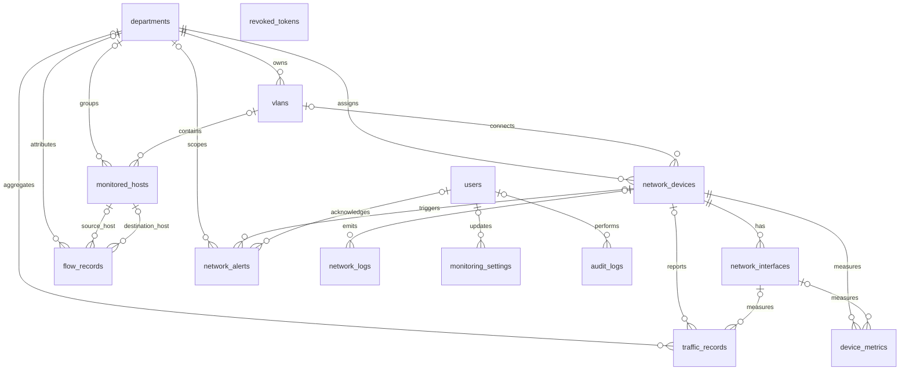

# Database schema design

This document defines the PostgreSQL data model for the Hospital Network
Monitoring and Usage Analytics System. The SQLAlchemy models and initial
Alembic migration in Step 4 implement this schema. This document remains the
design reference; it does not create database objects by itself.

## Design rules

- Use UUID primary keys for application entities.
- Store timestamps as `TIMESTAMPTZ` in UTC. Normalize incoming source times to
  UTC before persistence.
- Store network addresses as PostgreSQL `INET`; use `CIDR` for subnet ranges.
- Persist only authorized network metadata and aggregated usage. Never persist
  packet payloads, credentials, private messages, or browsing contents.
- Monitoring credentials are supplied through environment variables or a
  secrets manager. `monitoring_settings` must not contain secrets.
- Do not create a metric row for a value that the source did not provide.
  Represent source health separately so unavailable is not confused with zero.
- Use foreign keys and database constraints as a second line of validation
  behind API/Pydantic validation.

## Entity relationship diagram

`o|` indicates an optional relationship. Traffic and flow records may have no
department attribution when the monitoring source cannot reliably associate
them with one.

## Tables

### `users`

Application accounts; no hospital patient or clinical user data belongs here.

| Column | Type | Constraints / purpose |
|---|---|---|
| `id` | UUID | Primary key |
| `email` | VARCHAR(320) | Required, unique, normalized to lowercase |
| `password_hash` | VARCHAR(255) | Required; store an Argon2id hash, never a password |
| `role` | VARCHAR(16) | Required; `admin` or `viewer` |
| `is_active` | BOOLEAN | Required, default true |
| `last_login_at` | TIMESTAMPTZ | Nullable |
| `created_at`, `updated_at` | TIMESTAMPTZ | Required, UTC |

### `departments`

| Column | Type | Constraints / purpose |
|---|---|---|
| `id` | UUID | Primary key |
| `code` | VARCHAR(32) | Required, unique stable identifier |
| `name` | VARCHAR(120) | Required |
| `description` | VARCHAR(500) | Optional |
| `created_at`, `updated_at` | TIMESTAMPTZ | Required, UTC |

### `vlans` (supporting table)

Separates VLANs from departments so a department can have multiple network
segments and device/host attribution can be explicit.

| Column | Type | Constraints / purpose |
|---|---|---|
| `id` | UUID | Primary key |
| `department_id` | UUID | Required FK to `departments.id`, `RESTRICT` on delete |
| `vlan_number` | SMALLINT | Required, range 1–4094; unique |
| `name` | VARCHAR(120) | Required |
| `subnet` | CIDR | Optional |
| `created_at`, `updated_at` | TIMESTAMPTZ | Required, UTC |

### `network_devices`

| Column | Type | Constraints / purpose |
|---|---|---|
| `id` | UUID | Primary key |
| `department_id` | UUID | Optional FK to `departments.id`, `SET NULL` on delete |
| `vlan_id` | UUID | Optional FK to `vlans.id`, `SET NULL` on delete |
| `name` | VARCHAR(120) | Required display name |
| `hostname` | VARCHAR(253) | Optional |
| `ip_address` | INET | Required management address |
| `device_type` | VARCHAR(24) | Required; `router`, `switch`, `firewall`, `access_point` |
| `status` | VARCHAR(20) | Required; `online`, `offline`, `unknown`, `unavailable` |
| `source` | VARCHAR(32) | Required; e.g. `demo`, `zabbix`, `snmp`, `manual` |
| `source_device_id` | VARCHAR(160) | Optional provider-side identifier |
| `monitoring_enabled` | BOOLEAN | Required, default true |
| `last_seen_at` | TIMESTAMPTZ | Nullable |
| `created_at`, `updated_at` | TIMESTAMPTZ | Required, UTC |

Add a unique constraint on (`source`, `source_device_id`) when
`source_device_id` is not null, plus indexes on `status`, `department_id`, and
`device_type`.

### `network_interfaces`

| Column | Type | Constraints / purpose |
|---|---|---|
| `id` | UUID | Primary key |
| `device_id` | UUID | Required FK to `network_devices.id`, `CASCADE` on delete |
| `if_index` | INTEGER | Required, nonnegative source interface index |
| `name` | VARCHAR(120) | Required |
| `description` | VARCHAR(500) | Optional |
| `speed_bps` | BIGINT | Optional, nonnegative |
| `admin_state` | VARCHAR(16) | Optional; `up`, `down`, `unknown` |
| `oper_state` | VARCHAR(16) | Optional; `up`, `down`, `unknown` |
| `last_seen_at` | TIMESTAMPTZ | Nullable |
| `created_at`, `updated_at` | TIMESTAMPTZ | Required, UTC |

Unique (`device_id`, `if_index`); index `device_id`.

### `monitored_hosts`

| Column | Type | Constraints / purpose |
|---|---|---|
| `id` | UUID | Primary key |
| `department_id` | UUID | Optional FK to `departments.id`, `SET NULL` on delete |
| `vlan_id` | UUID | Optional FK to `vlans.id`, `SET NULL` on delete |
| `ip_address` | INET | Required; observed network metadata |
| `hostname` | VARCHAR(253) | Optional |
| `source` | VARCHAR(32) | Required collector/source name |
| `source_host_id` | VARCHAR(160) | Optional provider-side identifier |
| `first_seen_at`, `last_seen_at` | TIMESTAMPTZ | Required, UTC |
| `created_at`, `updated_at` | TIMESTAMPTZ | Required, UTC |

Index `ip_address`, (`department_id`, `last_seen_at`), and
(`vlan_id`, `last_seen_at`). A partial unique index on (`source`,
`source_host_id`) applies when the provider ID is non-null. IP address is not
globally unique because addresses can be reassigned over time.

### `traffic_records`

Time-bucketed interface/device traffic used for history and department
aggregates; this is not packet capture.

| Column | Type | Constraints / purpose |
|---|---|---|
| `id` | UUID | Primary key |
| `interval_start`, `interval_end` | TIMESTAMPTZ | Required; end must be >= start |
| `department_id` | UUID | Optional FK to `departments.id`, `SET NULL` on delete |
| `device_id` | UUID | Optional FK to `network_devices.id`, `SET NULL` on delete |
| `interface_id` | UUID | Optional FK to `network_interfaces.id`, `SET NULL` on delete |
| `direction` | VARCHAR(16) | Required; `ingress` or `egress` |
| `bytes_transferred` | BIGINT | Required, nonnegative |
| `packets` | BIGINT | Optional, nonnegative count |
| `bit_rate_bps` | BIGINT | Optional, nonnegative measured rate |
| `source` | VARCHAR(32) | Required collector/source name |
| `source_record_id` | VARCHAR(160) | Optional provider-side record ID |
| `created_at` | TIMESTAMPTZ | Required, UTC ingestion time |

Partial unique (`source`, `source_record_id`) when the source ID is non-null.
Indexes on `interval_start`, (`department_id`, `interval_start`),
(`device_id`, `interval_start`), and (`interface_id`, `interval_start`).

### `flow_records`

Normalized flow metadata from an authorized flow exporter or monitoring API.
No payload fields are defined.

| Column | Type | Constraints / purpose |
|---|---|---|
| `id` | UUID | Primary key |
| `flow_start`, `flow_end` | TIMESTAMPTZ | Required; end must be >= start |
| `department_id` | UUID | Optional FK to `departments.id`, `SET NULL` on delete |
| `source_host_id`, `destination_host_id` | UUID | Optional FKs to `monitored_hosts.id`, `SET NULL` |
| `source_ip`, `destination_ip` | INET | Required endpoint metadata |
| `source_port`, `destination_port` | INTEGER | Optional, range 0–65535 |
| `protocol` | VARCHAR(32) | Required normalized protocol label |
| `application_name` | VARCHAR(120) | Optional, only if supplied by source |
| `bytes_transferred` | BIGINT | Required, nonnegative |
| `packets` | BIGINT | Optional, nonnegative |
| `source` | VARCHAR(32) | Required exporter/source |
| `source_record_id` | VARCHAR(160) | Optional provider-side record ID |
| `created_at` | TIMESTAMPTZ | Required, UTC ingestion time |

Partial unique (`source`, `source_record_id`) when non-null. Indexes on
`flow_start`, (`department_id`, `flow_start`), (`protocol`, `flow_start`), and
(`application_name`, `flow_start`).

### `device_metrics`

Numeric time-series metrics such as CPU and memory utilization. Missing or
unsupported metrics are absent, not synthesized.

| Column | Type | Constraints / purpose |
|---|---|---|
| `id` | UUID | Primary key |
| `device_id` | UUID | Required FK to `network_devices.id`, `CASCADE` on delete |
| `interface_id` | UUID | Optional FK to `network_interfaces.id`, `SET NULL` |
| `metric_name` | VARCHAR(48) | Required normalized metric key |
| `value` | NUMERIC(18,6) | Required measured value |
| `unit` | VARCHAR(24) | Required, e.g. `percent`, `bytes`, `celsius` |
| `recorded_at` | TIMESTAMPTZ | Required source measurement time in UTC |
| `source` | VARCHAR(32) | Required collector/source name |
| `source_record_id` | VARCHAR(160) | Optional provider-side record ID |
| `created_at` | TIMESTAMPTZ | Required UTC ingestion time |

Partial unique (`source`, `source_record_id`) when non-null. Indexes on
(`device_id`, `recorded_at`) and (`metric_name`, `recorded_at`).

### `network_alerts`

| Column | Type | Constraints / purpose |
|---|---|---|
| `id` | UUID | Primary key |
| `department_id` | UUID | Optional FK to `departments.id`, `SET NULL` on delete |
| `device_id` | UUID | Optional FK to `network_devices.id`, `SET NULL` on delete |
| `alert_type` | VARCHAR(40) | Required rule/category key |
| `severity` | VARCHAR(16) | Required; `info`, `warning`, `critical` |
| `status` | VARCHAR(16) | Required; `open`, `acknowledged`, `resolved` |
| `title` | VARCHAR(160) | Required |
| `description` | VARCHAR(1000) | Optional normalized explanation |
| `detected_at` | TIMESTAMPTZ | Required, UTC |
| `acknowledged_by` | UUID | Optional FK to `users.id`, `SET NULL` on delete |
| `acknowledged_at`, `resolved_at` | TIMESTAMPTZ | Nullable UTC timestamps |
| `created_at`, `updated_at` | TIMESTAMPTZ | Required, UTC |

Indexes on (`status`, `detected_at`), (`severity`, `detected_at`), and
(`department_id`, `detected_at`).

### `network_logs`

Normalized network event metadata, including sanitized syslog-derived events.
Do not store raw payloads or unbounded vendor log text.

| Column | Type | Constraints / purpose |
|---|---|---|
| `id` | UUID | Primary key |
| `device_id` | UUID | Optional FK to `network_devices.id`, `SET NULL` on delete |
| `source` | VARCHAR(32) | Required event source |
| `event_type` | VARCHAR(48) | Required normalized event key |
| `severity` | VARCHAR(16) | Required normalized severity |
| `summary` | VARCHAR(500) | Required sanitized summary |
| `source_event_id` | VARCHAR(160) | Optional provider-side event ID |
| `occurred_at` | TIMESTAMPTZ | Required event time in UTC |
| `received_at` | TIMESTAMPTZ | Required UTC ingestion time |

Partial unique (`source`, `source_event_id`) when non-null. Indexes on
`occurred_at`, (`device_id`, `occurred_at`), and (`severity`, `occurred_at`).

### `monitoring_settings`

Non-secret monitoring configuration and service health state. Credentials are
resolved by the backend from environment variables or a secrets manager.

| Column | Type | Constraints / purpose |
|---|---|---|
| `id` | UUID | Primary key |
| `provider` | VARCHAR(32) | Required provider key, such as `zabbix` or `ntopng` |
| `setting_key` | VARCHAR(80) | Required configuration key |
| `setting_value` | JSONB | Required non-secret configuration |
| `enabled` | BOOLEAN | Required, default false |
| `service_status` | VARCHAR(20) | Required; `unknown`, `available`, `unavailable` |
| `last_checked_at` | TIMESTAMPTZ | Nullable UTC timestamp |
| `updated_by` | UUID | Optional FK to `users.id`, `SET NULL` on delete |
| `created_at`, `updated_at` | TIMESTAMPTZ | Required, UTC |

Unique (`provider`, `setting_key`); index `provider`.

### `audit_logs` (supporting table)

Required to audit administrative actions without retaining sensitive request
bodies.

| Column | Type | Constraints / purpose |
|---|---|---|
| `id` | UUID | Primary key |
| `actor_user_id` | UUID | Optional FK to `users.id`, `SET NULL` on delete |
| `action` | VARCHAR(80) | Required action key |
| `resource_type` | VARCHAR(48) | Required resource type |
| `resource_id` | UUID | Optional affected entity ID |
| `outcome` | VARCHAR(16) | Required; `success` or `failure` |
| `metadata` | JSONB | Required, default `{}`; allowlisted, non-secret fields only |
| `created_at` | TIMESTAMPTZ | Required, UTC event time |

Indexes on (`actor_user_id`, `created_at`) and (`resource_type`, `resource_id`,
`created_at`). Audit events should be append-only through application policy.

### `revoked_tokens` (supporting table)

Stores JWT IDs invalidated by logout so a token cannot be reused until expiry.
Expired rows are pruned on logout; deployments with high logout volume should
also run scheduled cleanup.

| Column | Type | Constraints / purpose |
|---|---|---|
| `id` | UUID | Primary key |
| `jti` | VARCHAR(36) | Required, unique JWT ID |
| `expires_at` | TIMESTAMPTZ | Required token expiration time in UTC |
| `created_at` | TIMESTAMPTZ | Required UTC revocation time |

Index `expires_at` for expiration cleanup.

## Indexing, deduplication, and retention

- Use B-tree indexes for foreign keys and common time/status filters listed
  above. PostgreSQL does not automatically index referencing foreign-key
  columns.
- Apply partial unique indexes to provider record IDs to make collector retries
  idempotent while still allowing sources that do not provide stable IDs.
- For high-volume time-series tables (`traffic_records`, `flow_records`,
  `device_metrics`, and `network_logs`), start with ordinary tables and measure
  volume. Add time-based partitioning and an approved retention policy when
  scale and operational requirements are known.
- Keep aggregated traffic statistics longer than detailed flow records where
  policy requires different retention periods. Configure retention rather
  than silently deleting historical data.
- Use database transactions for alert status transitions and write a separate
  audit event for administrative changes.

## Relationship and deletion policy

- Department deletion is restricted while VLANs depend on it. Devices, hosts,
  traffic, and alerts may retain their history with department attribution set
  to null.
- Deleting a device cascades to its interface inventory; historical traffic
  and metrics retain their rows with optional device/interface attribution
  cleared.
- User deletion preserves audit and alert history by setting actor/acknowledger
  references to null.
- Production migrations should review foreign-key deletion rules and retention
  requirements before applying them to existing hospital data.
